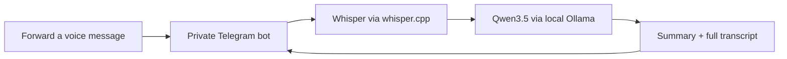

# Telegram Voice Summary Bot

Forward an English or Russian voice message to your own Telegram bot. Get a concise summary and a button for the full transcript. Speech recognition and summarization run on your Mac with **Whisper + Qwen3.5**.



## What is included

- English/Russian voice notes and audio files, up to five minutes and 20 MB.
- Private chats restricted to an explicit user allowlist.
- Local Apple Silicon speech recognition, with Qwen3.5 9B for summaries.
- Summaries condense the whole transcript with controlled rephrasing, removing filler and repetition. Explicitly requested translations are labeled as machine translations.
- A durable SQLite queue, one inference job at a time, and duplicate detection.
- Summary language selection, transcript download and temporary-audio cleanup.
- A standalone text-summary command that other local tools can reuse.
- Offline automated tests and GitHub Actions checks.

This is an initial personal-use release. The system prompt asks Qwen to preserve names, amounts, negation, speaker commitments and pending decisions. A length check prevents most of a long transcript being returned as its summary. Neither is a guarantee of factual accuracy: speech recognition and rephrasing can introduce errors. Check important details against the full transcript and audio. AI processing runs locally; the audio and returned text still travel through Telegram. There is no cloud AI fallback.

## macOS setup

Use Python 3.12+ and [uv](https://docs.astral.sh/uv/getting-started/installation/). On an Apple Silicon Mac with Homebrew:

```sh
brew install whisper-cpp ollama ffmpeg
git clone https://github.com/rnt-kmlff/telegram-voice-summary-bot.git
cd telegram-voice-summary-bot
uv sync --locked
bash scripts/download-whisper.sh
ollama serve
```

Leave Ollama running. In another terminal in this directory:

```sh
ollama pull qwen3.5:9b
cp .env.example .env
chmod 600 .env
```

Create a dedicated bot with Telegram's **@BotFather** (`/newbot`). Put its token in `TELEGRAM_BOT_TOKEN` in `.env`. Keep this file private. Set `ALLOWED_USER_IDS` to your numeric Telegram user ID; the bot will refuse to start with an empty allowlist. The local setup helper can show the ID from a message sent to your new bot:

```sh
uv run voice-summary identify
```

Follow the terminal instructions, then add the displayed ID to `.env`. This helper only identifies a sender; it does not transcribe anything or enroll users automatically.

Check dependencies, then start:

```sh
uv run voice-summary doctor
uv run voice-summary bot
```

Keep the Mac awake and connected for replies. Incoming updates can wait on Telegram for at most 24 hours; longer offline periods can require forwarding again. The bot preserves pending updates at startup. See [Telegram's update retention](https://core.telegram.org/bots/api#getting-updates).

### Models

Default transcription uses multilingual `large-v3-turbo` through [whisper.cpp](https://github.com/ggml-org/whisper.cpp). To compare a lighter model:

```sh
bash scripts/download-whisper.sh small
WHISPER_MODEL_PATH=models/ggml-small.bin uv run voice-summary process recording.ogg
```

The default summary model is [`qwen3.5:9b`](https://ollama.com/library/qwen3.5:9b), served on `127.0.0.1:11434`. Both the URL and selected model are checked to keep inference local. The same Ollama installation and model can be reused by other applications. Keep requests modest on machines with limited memory; this bot runs speech recognition and summarization sequentially. The smaller `qwen3.5:4b` remains configurable through `OLLAMA_MODEL`, but showed more factual changes in the initial rephrasing trials.

## Using the bot

Forward or send a voice message or audio file in a private chat. The bot acknowledges receipt, then updates that message with a short paragraph covering the main point and important requests or qualifications. **Full transcript** returns a text file with the complete summary and original transcript. Previously cached excerpt-style replies remain labeled as excerpts until replaced or expired.

- `/start` or `/help`: brief instructions.
- `/language auto`, `/language en`, `/language ru`: choose the summary language. `auto` follows the source language. A summary requested in a different language is labeled as machine-translated and should be checked against the original transcript.
- `/status`: number of pending messages.

If processing fails, forward the message again to retry. If only summarization fails, the available transcript remains accessible. This initial version does not ingest chat histories, join groups, send messages to other people, or execute instructions spoken in a recording.

## Local use without Telegram

These commands do not require a bot token:

```sh
uv run voice-summary transcribe recording.ogg
uv run voice-summary process recording.ogg --language en
uv run voice-summary summarize transcript.txt --language auto
```

`process` and `summarize` return JSON. The summarize command is a small local helper suitable for reviewed use from Codex. It does not grant Qwen file access, tools, or authority to change anything. See [reusing the local model](docs/local-model-reuse.md).

## Data and operation

`.env`, recordings, model weights, the local database and logs are excluded from Git. Temporary downloaded and converted audio is removed after processing. SQLite holds queue metadata and recent transcripts/summaries in a directory restricted to the current account. Completed/failed records expire after 24 hours by default; cleanup runs while the bot is active and on startup. This is logical deletion, not a guarantee of forensic erasure or deletion from backups/Telegram.

Only run one bot process per token. A local process lock prevents duplicate pollers in the same data directory. Jobs interrupted during inference are requeued on restart. Telegram replies and SQLite cannot share a transaction: a crash at the wrong time can leave an outdated status message, and manual forwarding may be required. Pending jobs are bounded; `/status` shows the queue size.

For optional bot startup at login, keeping the Mac awake, running Ollama and troubleshooting, see [macOS operation](docs/macos-operation.md).

## Development

```sh
uv sync --locked --group dev
uv run ruff check .
uv run ruff format --check .
uv run pytest
```

Tests use synthetic fixtures and mocked network responses. They do not contact Telegram or download AI models. See [evaluation notes](docs/evaluation.md) for what a real-audio pilot should check.

## License

MIT for this repository. Model weights and dependencies retain their own licenses. This is an independent project, unaffiliated with Telegram, OpenAI, Alibaba or Ollama.
